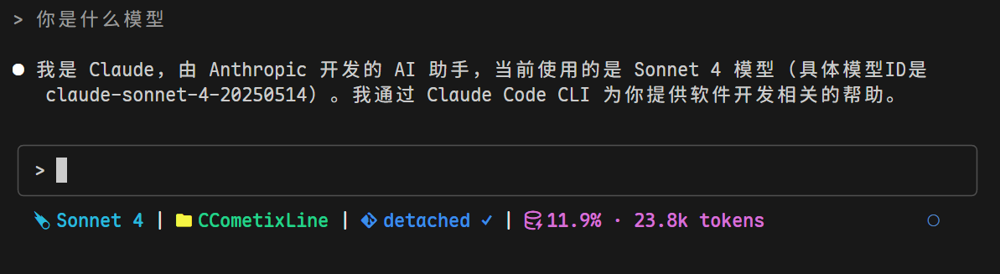

# PackyCC

A high-performance Claude Code statusline tool written in Rust with Git integration, real-time usage tracking, and API quota monitoring.

> Fork of [CCometixLine](https://github.com/Haleclipse/CCometixLine) with added PackyCode API integration and real-time quota monitoring.


## Screenshots



The statusline shows: Model | Directory | Git Branch Status | Context Window | Daily Spent

## Features

- **High performance** with Rust native speed
- **Git integration** with branch, status, and tracking info  
- **Model display** with simplified Claude model names
- **Usage tracking** based on transcript analysis
- **API quota monitoring** showing daily spending from PackyCode API
- **Directory display** showing current workspace
- **Clean design** with customizable icons
- **Simple configuration** via command line options

## Installation

Download from [Releases](https://github.com/petiky/packycc/releases):

### Linux

```bash
mkdir -p ~/.claude/ccline
wget https://github.com/petiky/packycc/releases/latest/download/ccline-linux-x64.tar.gz
tar -xzf ccline-linux-x64.tar.gz
cp ccline ~/.claude/ccline/
chmod +x ~/.claude/ccline/ccline
```

### macOS (Intel)

```bash  
mkdir -p ~/.claude/ccline
wget https://github.com/petiky/packycc/releases/latest/download/ccline-macos-x64.tar.gz
tar -xzf ccline-macos-x64.tar.gz
cp ccline ~/.claude/ccline/
chmod +x ~/.claude/ccline/ccline
```

### macOS (Apple Silicon)

```bash
mkdir -p ~/.claude/ccline  
wget https://github.com/petiky/packycc/releases/latest/download/ccline-macos-arm64.tar.gz
tar -xzf ccline-macos-arm64.tar.gz
cp ccline ~/.claude/ccline/
chmod +x ~/.claude/ccline/ccline
```

### Windows

```powershell
# Create directory and download
New-Item -ItemType Directory -Force -Path "$env:USERPROFILE\.claude\ccline"
Invoke-WebRequest -Uri "https://github.com/Haleclipse/CCometixLine/releases/latest/download/ccline-windows-x64.zip" -OutFile "ccline-windows-x64.zip"
Expand-Archive -Path "ccline-windows-x64.zip" -DestinationPath "."
Move-Item "ccline.exe" "$env:USERPROFILE\.claude\ccline\"
```

### Claude Code Configuration

Add to your Claude Code `settings.json`:

**Linux/macOS:**
```json
{
  "statusLine": {
    "type": "command", 
    "command": "~/.claude/ccline/ccline",
    "padding": 0
  }
}
```

**Windows:**
```json
{
  "statusLine": {
    "type": "command", 
    "command": "%USERPROFILE%\\.claude\\ccline\\ccline.exe",
    "padding": 0
  }
}
```

### Build from Source

```bash
git clone https://github.com/petiky/packycc.git
cd packycc
cargo build --release

# Linux/macOS
mkdir -p ~/.claude/ccline
cp target/release/ccometixline ~/.claude/ccline/ccline
chmod +x ~/.claude/ccline/ccline

# Windows (PowerShell)
New-Item -ItemType Directory -Force -Path "$env:USERPROFILE\.claude\ccline"
copy target\release\ccometixline.exe "$env:USERPROFILE\.claude\ccline\ccline.exe"
```

## Usage

```bash
# Basic usage (displays all enabled segments)
ccline

# Show help
ccline --help

# Print default configuration  
ccline --print-config

# TUI configuration mode (planned)
ccline --configure
```

## Default Segments

Displays: `Model | Directory | Git Branch Status | Context Window | Today: $X.XX`

### Git Status Indicators

- Branch name with Nerd Font icon
- Status: `✓` Clean, `●` Dirty, `⚠` Conflicts  
- Remote tracking: `↑n` Ahead, `↓n` Behind

### Model Display

Shows simplified Claude model names:
- `claude-3-5-sonnet` → `Sonnet 3.5`
- `claude-4-sonnet` → `Sonnet 4`
- `claude-4-1-opus` → `Opus 4.1`

The live reasoning effort follows the model name with an uppercase first letter, for example `Sonnet 4.5 High`.
It reads `effort.level` from Claude Code's status line input and is hidden when unavailable.

### Context Window Display

Token usage percentage and size read from `context_window.current_usage` in Claude Code's status line input.

Cache hit rate follows the context display, for example `7.75% (15.50K/200.00K) · Cache 91.00%`.
`Cache` uses the main conversation's cumulative, token-weighted `prompt_cache.hit_ratio` (Claude Code v2.1.251+; excludes subagents).
When unavailable, `Cache(last)` shows the last API request's cache read tokens divided by all input tokens (uncached input + cache writes + cache reads).
Unknown rates are hidden. The context token count is the latest request's input size, not cumulative session usage.

### Subscription Quota Display

For claude.ai Pro/Max (OAuth) sessions, shows `rate_limits` from Claude Code's status line input, for example `5h 30% (14:12) · 7d 41% (2d4h)`.
The 5-hour window shows its local reset time; the 7-day window shows the time remaining until reset.
Labels are dim gray; values are green below 70%, yellow from 70%, red from 90%.
Each window also shows the even share of its remaining quota, `≈13%/h` until the 5-hour reset and `≈10%/天` (per day) until the 7-day reset; it is hidden when less than one hour/day remains.
When the average pace since the window opened would reach 100% before the reset, a red warning shows when it runs out, for example `⚠13:05` or `⚠周四 20:43` (Thursday).
The warning waits until the window is at least 15 minutes (5-hour) or 12 hours (7-day) old, and lags behind if your recent pace differs from the average. Hidden for API key sessions and before the first API response.
To keep the countdown current while idle, set `"refreshInterval"` in your `statusLine` settings.

### Line Wrapping

When the status line is wider than the terminal (`COLUMNS`, set by Claude Code), it wraps between segments instead of inside one.

### API Quota Display

Shows daily API spending from PackyCode API when configured in `~/.config/claude/settings.json`.

## Configuration

For PackyCode API integration, add to `~/.config/claude/settings.json`:

```json
{
  "env": {
    "ANTHROPIC_BASE_URL": "https://api.packycode.com",
    "ANTHROPIC_AUTH_TOKEN": "your-api-key"
  },
  "info_url": "https://www.packycode.com/api/backend/users/info"
}
```

## Performance

- **Startup time**: < 50ms (vs ~200ms for TypeScript equivalents)
- **Memory usage**: < 10MB (vs ~25MB for Node.js tools)
- **Binary size**: ~2MB optimized release build

## Requirements  

- Git (optional, for git integration)  
- Terminal with Nerd Font support
- Claude Code for statusline integration

## Development

```bash
# Build development version
cargo build

# Run tests
cargo test

# Build optimized release
cargo build --release
```

## Roadmap

- [ ] TOML configuration file support
- [ ] TUI configuration interface
- [ ] Custom themes
- [ ] Plugin system
- [ ] Cross-platform binaries

## Contributing

Contributions are welcome! Please feel free to submit issues or pull requests.

## Credits

- Original project: [CCometixLine](https://github.com/Haleclipse/CCometixLine) by Haleclipse
- PackyCode API integration and enhancements by [petiky](https://github.com/petiky)

## License

This project is licensed under the [MIT License](LICENSE).

## Star History

[](https://star-history.com/#petiky/packycc&Date)
